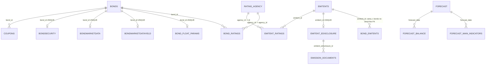

# Отчёт по структуре и оптимизации БД BondsScreener

**Дата проверки:** 13 ноября 2026 г.  
**Проверенная основная БД:** `db_repository/data/db/bonds.db`  
**Метод:** схема, миграции, ORM и SQL-запросы проекта сопоставлены с локальными SQLite-файлами. Файлы БД открывались только для чтения.

## Краткое резюме

Основная БД исправна на момент проверки: `quick_check` вернул `ok`, `foreign_key_check` не обнаружил нарушений, проверенные связи без сиротских строк. При этом обнаружены важные улучшения:

1. На подключениях основной БД выключена проверка внешних ключей SQLite. Объявленные `FOREIGN KEY` и `ON DELETE CASCADE` сейчас не защищают данные при обычной работе приложения.
2. Поиск по ISIN и некоторые фильтры выполняют полный просмотр `bonds`: подходящих индексов нет, а выражения `UPPER(TRIM(...))` мешают использовать обычный индекс.
3. Пять индексов в `bonds.db` избыточны: их левые префиксы уже покрывают первичные или уникальные составные индексы.
4. Таблица `bond_trading_history` содержит 2,596,068 строк в отдельном файле `history_db.db` размером 441,200,640 байт (420.7 MiB). Это основная часть дискового объёма набора баз.
5. В файле `bonds.db` свободны 409 страниц по 4096 байт — около 1.60 MiB; их можно вернуть файловой системе после безопасного `VACUUM`.
6. Локальный файл БД имеет ревизию Alembic `025_baseline_current_schema`, а код проекта содержит следующую миграцию `026_bond_description`. Поэтому фактическая таблица `bond_emitents` ещё не заменена на `bond_description`.

Самые безопасные первые шаги: включить enforcement внешних ключей, добавить индекс для поиска по ISIN, убрать подтверждённо дублирующие индексы, затем оценить `WITHOUT ROWID` для таблицы истории на копии БД. Миграции следует выполнять после резервного копирования и с учётом работающих процессов.

## 1. Состав и размер файлов

| Файл | Размер | Строки / заметки |
|---|---:|---|
| `bonds.db` | 48,336,896 байт (46.1 MiB) | 29 таблиц вместе с `alembic_version`; 28 прикладных таблиц |
| `history_db.db` | 441,200,640 байт (420.7 MiB) | `bond_trading_history`: 2,596,068 строк, 3,876 разных `secid`, даты от 2002-05-20 до 2026-11-06 |
| `portfolios.db` | 2,326,528 байт (2.22 MiB) | отдельная схема портфелей |
| `blog.db` | 45,056 байт | отдельная схема блога |

Файлы истории, портфелей и блога не являются таблицами внутри `bonds.db`. В частности, оптимизация только `bonds.db` не уменьшит файл истории размером 420.7 MiB.

У `bonds.db`: размер страницы 4096 байт, всего 11,801 страниц, из них 409 находятся во freelist. Это 1,675,264 байта свободных страниц внутри файла, примерно 3.5% текущего файла. `VACUUM` может вернуть большую часть этого пространства операционной системе; точный итог зависит от пересборки страниц.

Сборка SQLite в используемом Python не предоставляет таблицу `dbstat`, поэтому точные размеры отдельных таблиц и индексов получить не удалось. Объёмные рекомендации по индексам и истории ниже основаны на схеме и количестве строк, а не на замере байтов каждого объекта.

## 2. Как связаны таблицы

Основной ключ облигации — `bonds.id`. Внешний естественный ключ для биржевого инструмента — уникальная пара `(secid, boardid)`. В таблице 4,170 строк, 3,889 разных `secid`: 281 дополнительная строка относится к инструментам, представленным на нескольких режимах торгов.

В фактической ревизии `025` таблица `bond_emitents` содержит одну строку на `secid`; внешний ключ в ней ведёт к `emitents.id`, но ссылки на `bonds` по внешнему ключу нет. Связь с облигациями строится по `secid`.

Таблицы событий `events_details` содержат `emitent_inn`, `isin` и регистрационные номера как значения, но FK на `emitents` или `bonds` не объявлены. Макроданные (`keyrate`, `ruonia`, `currencyrate`, `kbd`, `ipc_*`, `inflation_*`) являются независимыми временными рядами. Данные истории торгов вынесены в другой файл и не имеют FK в `bonds.db`; связь с инструментом — по `(secid, boardid)`.

`users` находится в `bonds.db`, а `portfolios.user_id` — в отдельном `portfolios.db`. SQLite не может обеспечить обычный FK между этими файлами, поэтому связь пользователя и портфеля контролируется приложением.

## 3. Проверки целостности и проблемы связей

### Результаты проверок

- `PRAGMA quick_check` → `ok`.
- `PRAGMA foreign_key_check` → нарушений не найдено.
- Проверенные соединения coupons, ratings, emitent ratings и emission documents с родительскими строками → сиротских записей не найдено.
- Во всех трёх снимках `bondsecurity`, `bondmarketdata`, `bondmarketdatayield` `bond_id` заполнен; по одному уникальному снимку приходится на облигацию.
- `bonds` имеет уникальность `(secid, boardid)`, но ISIN не уникален: найдено 281 значение ISIN, встречающееся более одного раза. Это согласуется с представлением инструмента в нескольких режимах торгов; добавлять `UNIQUE(isin)` нельзя.

### Внешние ключи фактически не enforced

В основной БД внешние ключи присутствуют в DDL, однако `db_repository/core/database_init.py` создаёт SQLAlchemy engine без подключения `PRAGMA foreign_keys=ON`. При проверке нового соединения этого engine `PRAGMA foreign_keys` вернул `0`. Для SQLite это означает, что внешние ключи и каскадное удаление по умолчанию не исполняются на этом соединении.

Чистый результат `foreign_key_check` описывает текущее содержимое файла, но не гарантирует защиту новых записей. При удалении облигации или эмитента могут остаться дочерние строки, несмотря на `ON DELETE CASCADE` в схеме.

**Рекомендация:** включить `PRAGMA foreign_keys=ON` в обработчике создания каждого соединения основного SQLAlchemy engine. Проверить также прямые подключения через `sqlite3`; у каждого соединения настройка отдельная. Перед включением на рабочем экземпляре выполнить `foreign_key_check`, затем после включения повторить его и проверить операции удаления/обновления в изолированной копии.

### Несогласованный ключ агентства рейтинга

`bond_ratings.agency_id` ссылается на `rating_agency.agency_id` (внешний код агентства), а `emitent_ratings.agency_id` — на `rating_agency.id` (внутренний PK). Одинаково названное поле содержит разные виды идентификатора в двух таблицах. Сейчас данные валидны: `rating_agency.agency_id` уникален, а FK check нарушений не показывает.

**Рекомендация:** выбрать единый внутренний FK на `rating_agency.id` для обеих таблиц, сохранив внешний код в справочнике `agency_id`. Перенос выполнить отдельной миграцией с сопоставлением всех 3,693 рейтингов облигаций и 1,092 рейтингов эмитентов.

### Неоднозначность старой связи эмитента с облигацией

Из 3,874 строк `bond_emitents` у 279 `secid` в `bonds` найдено более одной строки, потому что эти инструменты торгуются на нескольких board. Старое сопоставление по одному `secid` не различает режим торгов. При этом текущая миграция `026_bond_description` соединяет legacy-таблицу с `bonds` по `secid`, что перенесёт запись эмитента на каждую строку с этим `secid`.

Это корректно, если все board-варианты являются одной и той же эмиссией. Если режимы могут иметь различный issuer/описание, перед применением 026 нужно согласовать правило выбора; надёжный ключ для биржевой строки — `(secid, boardid)`, а для описания эмиссии может требоваться отдельная сущность выпуска.

### Схема файла и миграций проекта расходятся

На диске применена ревизия `025_baseline_current_schema`; в репозитории уже есть миграция `026_bond_description`, которая переименовывает `bond_emitents`, создаёт `bond_description` с PK/FK `bond_id → bonds.id` и ссылкой `emitter_id → emitents.moex_id`. На локальной копии таблицы `bond_description` нет.

Перед запуском миграции проверьте описанную выше неоднозначность на 279 multi-board `secid`, создайте резервную копию и после применения подтвердите количество/состав связей. Проверка не запускала и не применяла миграции.

## 4. Индексы и ускорение поиска

Проверенные планы `EXPLAIN QUERY PLAN` показывают:

| Запрос | План на текущей БД | Вывод |
|---|---|---|
| `bonds WHERE secid = ?` | Использует уникальный индекс `(secid, boardid)` | Поиск по SECID уже индексирован |
| `bonds WHERE upper(trim(isin)) = ?` | Полный скан `bonds` | Нет индекса, соответствующего выражению |
| Диапазон по `maturity_date` | Полный скан `bonds` | Нет индекса по дате погашения |
| `rating + bond_type`, сортировка по доходности | Полный скан и временная сортировка | Нужны нормализация и реальные профили запросов, прежде чем добавлять составной индекс |
| `coupons WHERE bond_id=? AND coupondate>=?` | Использует PK `(bond_id,coupondate)` | Доступ к ближайшим купонам индексирован |

В проекте фильтры для ISIN и рейтинга выражены через `UPPER(TRIM(...))`. В текущих данных все проверенные ISIN и рейтинги уже сохранены в верхнем регистре без пробелов. Это позволяет упростить сравнения до обычного значения и использовать обычный индекс.

**Приоритетный индекс:** создать неуникальный индекс по `bonds.isin` и использовать точное сравнение нормализованного значения. Он ускорит поиск облигации по ISIN, используемый, в частности, при разборе портфеля. Индекс должен быть неуникальным из-за 281 повторяющейся группы ISIN.

Индекс по `maturity_date` можно рассмотреть, если фильтр по сроку погашения часто используется и список облигаций вырастет. Для этого нужно убрать `TRIM`/пустые sentinel-значения из рабочего запроса, нормализовать пустые даты в `NULL` и проверить план уже на полном запросе. Отдельные индексы на каждый числовой фильтр доходности/купона без частотности запросов увеличат запись и размер файла; сначала следует измерить типичные запросы.

### Индексы основной БД, дублирующие префиксы

| Индекс-кандидат на удаление | Уже покрывающий индекс | Почему можно убрать после повторной проверки запросов |
|---|---|---|
| `idx_coupons_bond_id` | PK `(bond_id, coupondate)` | Уникальный индекс PK начинается с `bond_id` и обслуживает поиск купонов по облигации |
| `idx_bond_ratings_bond_id` | `uq_bond_rating_date (bond_id, agency_id, rating_date)` | Составной уникальный индекс начинается с `bond_id` |
| `idx_emitent_ratings_emitent_id` | UNIQUE `(emitent_id, agency_id)` | Составной уникальный индекс начинается с `emitent_id` |
| `ix_describe_fields_section` | UNIQUE `(section, field_name)` | Составной индекс начинается с `section` |
| `ix_events_details_pseudo_guid` | UNIQUE `(pseudo_guid, event_date)` | Составной индекс начинается с `pseudo_guid` |

Удаление лишних индексов уменьшает файл и стоимость массовых upsert/записей. Точные байты экономии без `dbstat` не измерены. Индексы по `emitent_ratings.agency_id`, `events_details.event_date`, `events_details.emitent_inn`, `emission_documents.emitent_edisclosure_id` и уникальности агентств не являются дубликатами указанных составных индексов — их следует оставить.

## 5. Оптимизация дискового объёма

### Быстрое освобождение свободных страниц

`bonds.db` имеет 409 свободных страниц, около 1.60 MiB. После резервного копирования и остановки записывающих процессов можно выполнить `VACUUM` для основной БД. Перед операцией проверьте свободное место: SQLite перестраивает файл, поэтому временно требуется дополнительное пространство. Если используется WAL, сначала согласованно выполнить checkpoint.

### История торгов — крупнейший кандидат

`history_db.db` содержит 2.6 млн строк в одной таблице с 26 полями и составным PK `(secid, tradedate, boardid)`. Вторичных индексов у неё нет. Запросы по `secid` и диапазону `tradedate` уже соответствуют порядку ключа.

Для этой таблицы и таблицы `coupons` (118,992 строки, составной PK `(bond_id,coupondate)`) стоит на тестовой копии сравнить текущий размер с таблицей `WITHOUT ROWID`. Для таких таблиц с составным PK это может убрать отдельное хранение скрытого rowid и PK-индекса. Это не гарантированное число экономии: нужно построить копию, загрузить те же строки, измерить итоговый файл и проверить диапазонные запросы. Историческая таблица большая, поэтому миграция требует временного места примерно под копию и окна обслуживания.

Если старые котировки не должны постоянно находиться в оперативной БД, отдельный вариант — политика архивирования истории по годам/периодам с явным правилом доступности. Архивирование следует запускать после утверждения требований к хранению и доступу к историческим данным.

### Размеры колонок

SQLite не резервирует место по объявленной длине `VARCHAR(n)`; изменение `VARCHAR(64)` на `VARCHAR(32)` само по себе не сожмёт существующие строки. Существенный выигрыш дают удаление дублирующих индексов, освобождение freelist и изменение физического хранения большой таблицы истории после измерения.

## 6. Другие замечания по связям

- В `portfolios.db` есть индексы, которые тоже могут дублировать префиксы UNIQUE-индексов: `idx_portfolio_imports_portfolio_id`, `idx_portfolio_securities_portfolio_id`, `idx_portfolio_positions_portfolio_id`, `idx_portfolio_source_rows_import_id`. Их стоит проверять отдельно на фактических запросах портфельного репозитория.
- В `portfolio_repository.py` явно включён `PRAGMA foreign_keys=ON`; такое же явное включение нужно для основного engine. Это различие сейчас создаёт разное поведение внешних ключей по файлам.
- События связаны с эмитентом/выпуском только через текстовые значения (`emitent_inn`, `isin`, номера регистрации). Если нужны надёжные join-ы, следует добавить слой разрешения идентификаторов или FK после сверки источников; присоединять по свободному тексту без очистки нельзя.
- У таблиц макроэкономических временных рядов ключ по дате, а у прогнозов — `forecast.date` с дочерними строками по `(forecast_date, year)`. Эти небольшие таблицы уже имеют естественные ключи; дополнительных индексов для сокращения размера им не требуется.

## 7. Рекомендуемый порядок работ

| Приоритет | Изменение | Эффект | Условие / проверка |
|---|---|---|---|
| P0 | Включить FK enforcement для каждого соединения основной БД | Не допускать новые сиротские строки; реально исполнять каскады | До и после: `foreign_key_check`; проверить запись и удаление в копии |
| P1 | Неуникальный индекс `bonds.isin`; убрать `UPPER(TRIM())` там, где данные уже нормализованы | Ускорить точный поиск по ISIN | `EXPLAIN QUERY PLAN` должен показать индекс; сохранить повторы ISIN |
| P1 | Удалить 5 дублирующих индексов | Сократить файл и стоимость обновлений | Поиск всех SQL-запросов; миграция; повторный план для ключевых запросов |
| P1 | Проверить 026 на multi-board связях и применить только с резервной копией | Перейти от legacy `secid`-связи к FK `bond_id` | Согласовать 279 неоднозначных `secid`; сравнить mapping до/после |
| P2 | Свести оба рейтинговых FK к `rating_agency.id` | Устранить разные смыслы `agency_id` | Таблица соответствий, перенос и FK-check |
| P2 | На копии сравнить `WITHOUT ROWID` для history и coupons | Возможное существенное уменьшение файлов | Сравнить размер, время чтения/записи и диапазонные планы |
| P2 | Выполнить `VACUUM` `bonds.db` в окно обслуживания | Вернуть около 1.60 MiB свободных страниц | Резервная копия, свободное место, остановка писателей |
| P3 | Собрать реальные частые запросы/время и выбрать дополнительные составные индексы | Ускорить фильтры без лишней индексации | Не добавлять индекс только по синтетическому запросу |

## 8. Границы проверки

Проверка была read-only: миграции, индексы и данные не изменялись. Приложение и его тесты не запускались. Query plan проверен для репрезентативных запросов по SECID, ISIN, maturity, рейтингу и купонам; производственная частотность SQL-запросов недоступна. По этой причине рекомендация по индексам для фильтров maturity/rating/yield требует подтверждения реальной нагрузкой.
