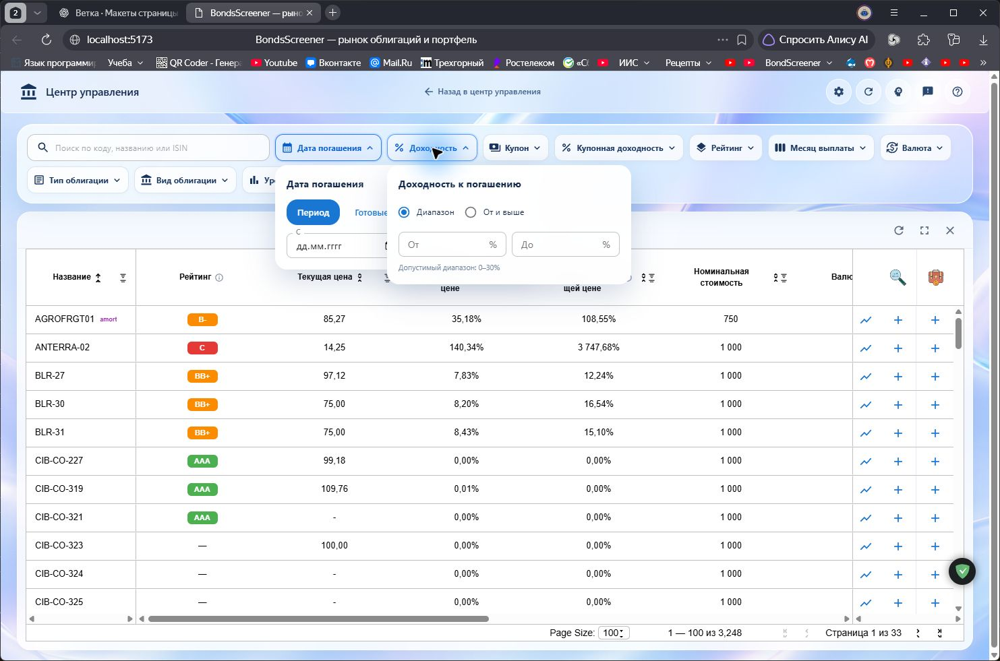
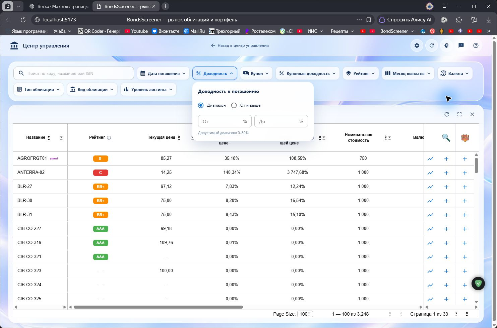
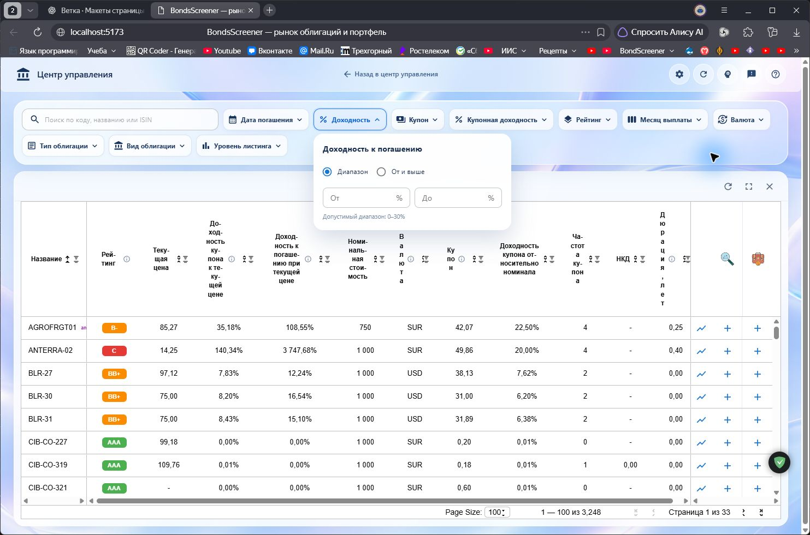
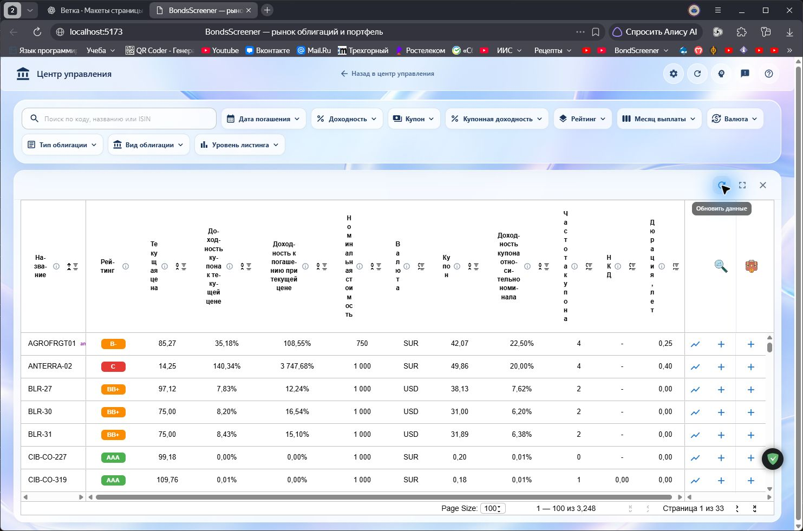

# Проверка фильтров рынка облигаций

**Дата:** 31.10.2026  
**Браузер:** Яндекс Браузер, локальный сайт `http://localhost:5173`  
**Результат:** проверены раскрытие/закрытие фильтров, выбор значений, применение и сброс. Код не менялся.

## Подтверждённые проблемы

### 1. Выпадающие панели остаются открытыми одновременно

**Как воспроизвести:** открыть «Дата погашения», затем нажать «Доходность». Обе панели остаются раскрытыми и накладываются. Нажатие Escape и клик по свободной области также не закрывают меню; закрывается только повторным нажатием на сам фильтр.

### 2. Применение срока погашения приводит к Server error

**Как воспроизвести:** «Дата погашения» → «Готовые диапазоны» → «1–3 года» → «Применить». Вместо таблицы отображается ошибка сервера; кнопка «Попробовать снова» не восстанавливает результат. Сброс фильтра возвращает таблицу.

### 3. Таблица сжимает колонки до нечитаемых заголовков

На странице рынка без активных фильтров колонки вмещаются в ширину таблицы без достаточной минимальной ширины. Заголовок «Дюрация, лет» разбивается почти по одному символу на строку. Обновление данных и сброс фильтров ширину не восстанавливают.

## Проверка фильтров

| Фильтр | Проверка | Результат |
|---|---|---|
| Поиск | `AGROFRGT01`, затем очистка и сброс | Работает: найдено 1 совпадение |
| Дата погашения | Готовый диапазон «1–3 года» | Выбор работает; применение падает с Server error |
| Доходность к погашению | Диапазон 5–15% | Работает, 467 строк |
| Ставка купона | Диапазон 5–10% | Работает, 386 строк |
| Купонная доходность | Диапазон 5–10% | Работает, 243 строки |
| Кредитный рейтинг | Границы «От A» и «До A» | Применяются; направление шкалы согласовано с результатом |
| Месяц выплаты | Январь | Работает, 1 559 строк |
| Валюта | USD | Работает, 140 строк |
| Тип облигации | ОФЗ | Работает, 87 строк |
| Вид облигации | Амортизируемая | Работает, 532 строки |
| Уровень листинга | 1 уровень | Работает, 546 строк |

Для мультивыбора чип выбранного значения отображается; изменения применяются кнопкой «Применить», сбрасываются через «Очистить всё». После проверки все фильтры очищены, рынок облигаций оставлен открытым.

## Дополнительные снимки тестовых состояний

Снимки `03-maturity-draft-count.png` и `06-rating-min-a-includes-lower-ratings.png` фиксируют промежуточные состояния проверки, а не подтверждённые дефекты.